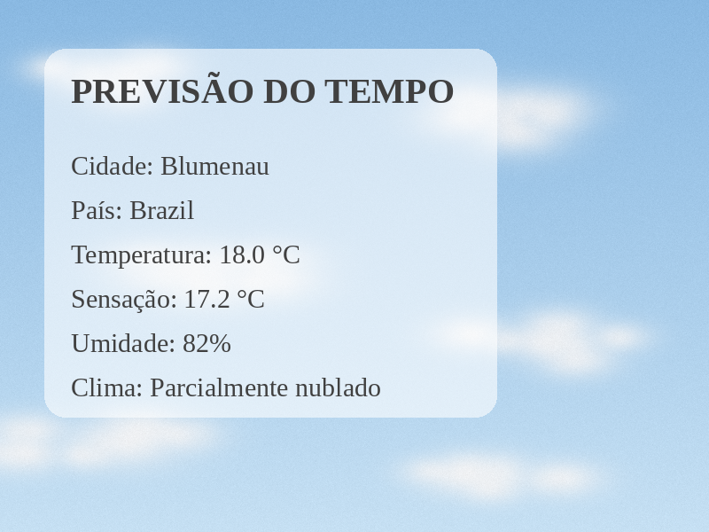

# Bot de clima para Telegram

Bot do Telegram em **Python** que recebe o nome de uma cidade, consulta o clima atual na **WeatherAPI** e responde com um **card em imagem** gerado na hora com o Pillow. Foi um projeto individual de estudo de Python.

> **English:** Telegram bot written in Python that looks up the current weather for a city through WeatherAPI and replies with an image card rendered with Pillow.



*Card gerado pelo código do bot, com dados de demonstração.*

## Como funciona

1. O usuário envia `/start` e recebe as instruções de uso.
2. Ao enviar o nome de uma cidade, o bot faz uma requisição HTTP à WeatherAPI e lê a resposta em JSON.
3. Com os dados de cidade, país, temperatura, sensação térmica, umidade e condição do tempo, o Pillow desenha o card sobre a imagem de fundo.
4. O card é salvo na pasta `imagens/` e enviado ao usuário. A imagem anterior é apagada antes de cada nova geração.

Se a cidade não existir ou a API não responder, o bot avisa o usuário em vez de travar.

## Tecnologias

| Biblioteca | Uso |
|---|---|
| `pyTelegramBotAPI` | Recebe as mensagens e envia texto e imagem pelo Telegram |
| `requests` | Faz a consulta à WeatherAPI |
| `Pillow` | Gera o card com o texto sobre a imagem de fundo |
| `os` | Lê as chaves das variáveis de ambiente, cria a pasta `imagens/` e remove o card anterior |

## Como rodar

1. Crie um bot com o [@BotFather](https://t.me/BotFather) no Telegram e guarde o token.
2. Crie uma conta gratuita na [WeatherAPI](https://www.weatherapi.com/) e gere uma chave de API.
3. Instale as dependências.
   ```bash
   pip install -r requirements.txt
   ```
4. Defina as chaves como variáveis de ambiente e rode o bot.

   **Linux ou macOS**
   ```bash
   export TELEGRAM_TOKEN="seu_token_do_telegram"
   export WEATHER_API_KEY="sua_chave_da_weatherapi"
   python main.py
   ```

   **Windows (PowerShell)**
   ```powershell
   $env:TELEGRAM_TOKEN="seu_token_do_telegram"
   $env:WEATHER_API_KEY="sua_chave_da_weatherapi"
   python main.py
   ```

As chaves nunca ficam no código, por isso o repositório pode ser público sem expor nenhuma credencial.

## Estrutura

```
bot-clima-telegram/
├── main.py            # código do bot
├── fundo.png          # imagem de fundo do card
├── fontes/            # fonte Liberation Serif (licença SIL OFL)
├── docs/              # imagem de exemplo
├── requirements.txt
└── imagens/           # criada automaticamente para os cards gerados
```

## Próximos passos

- **Um arquivo por usuário.** Hoje todos os usuários compartilham o mesmo `clima.png`. Com várias consultas ao mesmo tempo, o ideal é nomear o arquivo pelo id do chat ou gerar a imagem só em memória.
- **Previsão dos próximos dias.** A WeatherAPI também tem o endpoint `forecast.json`, que permitiria mostrar a previsão no card.
- **Ícone do tempo.** A resposta da API traz um ícone para cada condição, que poderia ir no card.

---

Desenvolvido por **Isadora Fernanda Zappe Schmidt** · [LinkedIn](https://www.linkedin.com/in/isadora-fernanda)
